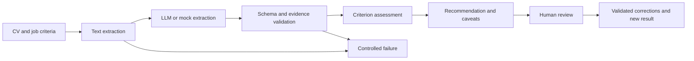

# CV Review Assistant

[](https://github.com/argabn/cv-review-assistant/actions/workflows/tests.yml)

Evidence-based CV review with structured extraction, explicit job criteria, and human oversight.

**Author: Arga Bona Simarmata**

Read a CV, extract candidate information, validate source evidence, and produce a review recommendation with concrete uncertainties. Reviewers can correct facts and recompute the assessment while preserving the original result. The system never makes a final hiring decision.

## Quick start

Python 3.10+ is required. Automated CI covers Python 3.11 and 3.12. From the repository root:

```sh
python3 -m venv .venv
source .venv/bin/activate
python -m pip install -r requirements.txt
python -m cvflow demo
```

On Windows, activate with `.venv\Scripts\activate` instead.

Open `output/demo/report.html` in your browser. The demo needs no model, API key, paid service, or network connection after dependencies are installed. It uses clearly labeled mock responses and synthetic data.

The command also generates a before/after human-review example and runs nine evaluation cases.

## Workflow



| Component | Responsibility |
|---|---|
| `documents.py` | Read PDF/TXT and bounded ZIP inputs without extracting archive paths |
| `extraction.py` | Ollama adapter, constrained JSON, source-line references, literal grounding |
| `contracts.py` | Explicit job, extraction, result, and review schemas |
| `pipeline.py` | Match evidence to configured criteria and produce non-final recommendations |
| `report.py` | Candidate profile, evidence matrix, and structured review form |
| `review.py` | Validate corrections against the original CV and job configuration |
| `evaluation.py` | Reproducible synthetic evaluation and sample workflow |

## Inputs and outputs

- Input: a UTF-8 TXT, text-based PDF, or ZIP of supported files, plus explicit [job criteria](samples/job.json).
- Facts: skills, education, experience, and projects, each with a source quote.
- Assessment: supported or not evidenced for each configured criterion.
- Recommendation: rationale, caveats, follow-up questions, and one of the following states.

| Status | Meaning |
|---|---|
| `ready_for_review` | Required criteria have initial source evidence; human verification is still needed |
| `needs_clarification` | At least one required criterion lacks evidence; this is not a rejection |
| `unable_to_assess` | Input, extraction, or configuration could not be used safely |

Every result has `human_review_required: true` and `final_decision: null`. A missing fact is not evidence that a candidate lacks the capability. No numerical hiring score is produced.

Inspect the [output contract](schemas/result.schema.json), [sample CV](samples/cv.txt), and [sample output](examples/demo/results.json). Prepared HTML examples are in [examples](examples); download an HTML report together with its neighboring `results.json`, or generate the report locally with the demo command.

## Run a single synthetic example

```sh
python -m cvflow run samples/cv.txt --job samples/job.json \
  --mode mock --fixture samples/response.json --out output/run
```

A mock fixture is paired with a specific source CV. It is not a general-purpose extractor.

## Optional local LLM

Install and run [Ollama](https://ollama.com), and use a model already available on your machine (`ollama list`). The tested model is `qwen2.5:1.5b`:

```sh
python -m cvflow run samples/cv.txt --job samples/job.json \
  --mode ollama --model qwen2.5:1.5b --out output/live
```

For a ZIP, start with one document:

```sh
python -m cvflow run synthetic-cvs.zip --job samples/job.json \
  --mode ollama --model qwen2.5:1.5b --limit 1 --out output/batch
```

Default batch size is one; the maximum is ten. Requests are sequential, with two CPU threads, 4096 context tokens, 1600 output tokens, and `keep_alive=0`. The application communicates with Ollama at localhost and does not upload documents to a cloud provider.

## Human review

In the report, review the source quotes and complete the reviewer panel. You may edit, remove, or add fact records using the correction form. **Export review** downloads a receipt; exporting alone does not apply the correction.

Validate and apply the receipt through the CLI:

```sh
python -m cvflow review \
  --results output/review-before/results.json \
  --receipt samples/review.json \
  --source samples/cv.txt --job samples/job.json \
  --out output/reviewed
```

The source and job hashes must match the original run. Corrections must satisfy the schema and evidence checks. The original result is preserved; the new report includes the reviewer's note. The included reviewer is explicitly fictional. Reviewer authentication and tamper-resistant audit storage are outside this prototype's scope.

## Evaluation

```sh
python -m unittest discover -s tests -v
python -m cvflow evaluate
```

If Node.js is available, test the report's correction-form behavior:

```sh
node tests/test_review_form.cjs
```

Current verification:

- 22 Python tests passed locally.
- Review-form behavior tests passed.
- Nine synthetic workflow scenarios passed.
- The deliberate omission case has recall **0.8**, despite passing its expected behavior check.
- One genuine local-model synthetic smoke test completed, with exact-record precision/recall **0.4**; formatting and field segmentation still require review.
- A limited check of three public resume examples from [Kaggle](https://www.kaggle.com/datasets/snehaanbhawal/resume-dataset) completed **1/3** documents; an unsupported date and a context-budget failure blocked the others. These external examples are not verified as fully synthetic. The documents and raw responses are not included here.

Test passing is not model accuracy. See [verification](docs/verification.md) and the [mock evaluation report](examples/evaluation/REPORT.md) for results and limitations.

## Limitations

- Not production-ready or validated for autonomous hiring decisions.
- Scanned, encrypted, oversized, or partially unreadable PDFs require manual handling.
- Ten pages / 10 MB per PDF; 12,000 characters per CV; a conservative 3,000-character budget per model request. Long inputs are rejected rather than silently shortened by the application.
- Simple section detection can miss unfamiliar headings or facts outside recognized sections.
- Criteria use explicitly configured terms/aliases; this is not unrestricted semantic job-description matching.
- Source presence does not prove correct relationships between fields, factual truth, or competence.
- Prompt-injection detection is heuristic; hidden PDF text and proxy bias are not comprehensively audited.
- A client timeout does not guarantee that server inference stopped. Use `ollama stop qwen2.5:1.5b` if needed.

Only synthetic samples and reports are committed. Generated outputs, archives, PDFs, environment files, and private folders are ignored by default.

## Documentation

- [Contribution and branch workflow](CONTRIBUTING.md)
- [Architecture and trade-offs](docs/architecture.md)
- [Requirements and interface review](docs/requirements-review.md)
- [Demo walkthrough](docs/demo-guide.md)
- [AI and tool usage](docs/ai-usage.md)
- [MIT license](LICENSE)
